# How the kit is built

[`workflow.md`](workflow.md) draws who does what and what triggers what. This page draws the
parts underneath: the files, the agents, the scripts and the CI that hold a day to the rules in
[`CLAUDE.md`](../CLAUDE.md) and [`specs/README.md`](../specs/README.md). Where the two pages
disagree with the rules, the rules win.

## The parts

Three layers have to agree: `plan.md`, the day specs and the code. Agents read them, scripts
check them, CI runs the scripts on every pull request, and the dashboard measures them after each
merge.

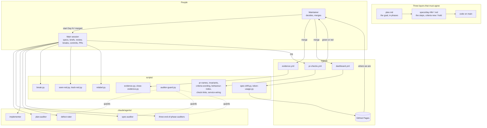

What decides and what only records:

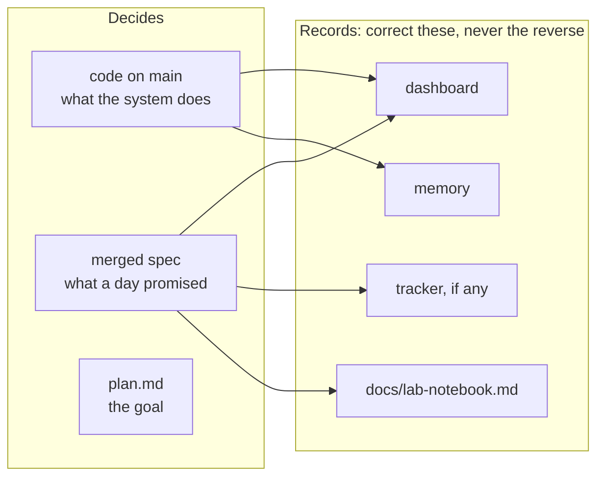

Where each part lives:

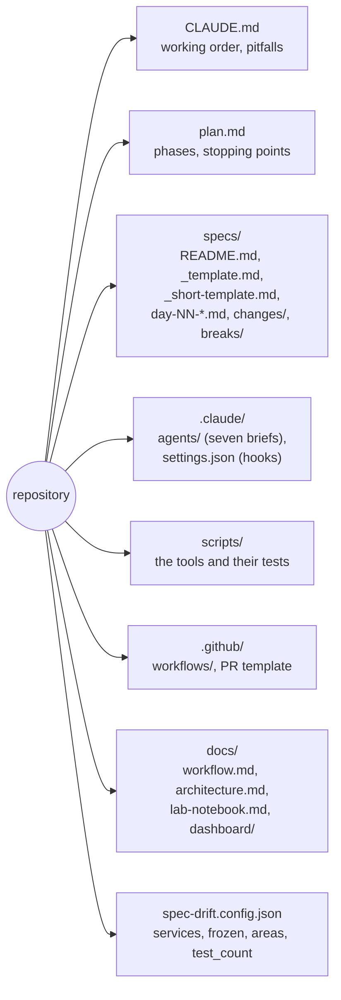

## Roles and their limits

Only the main session and the implementer write, and only the main session commits. The others
read from a fresh context and report; the maintainer decides what their findings become.

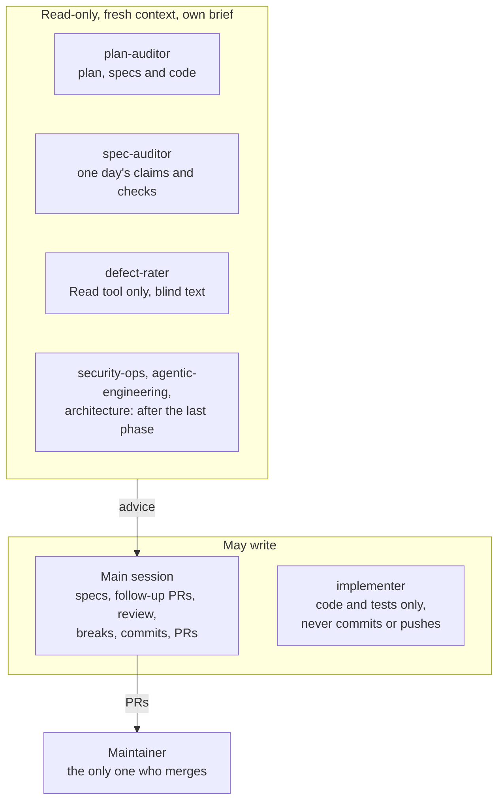

The auditors are held to reading by the hooks in [`.claude/settings.json`](../.claude/settings.json),
which run [`scripts/auditor-guard.py`](../scripts/auditor-guard.py). The guard reads the command,
not what a program does: a `python -c` that writes a file gets through.

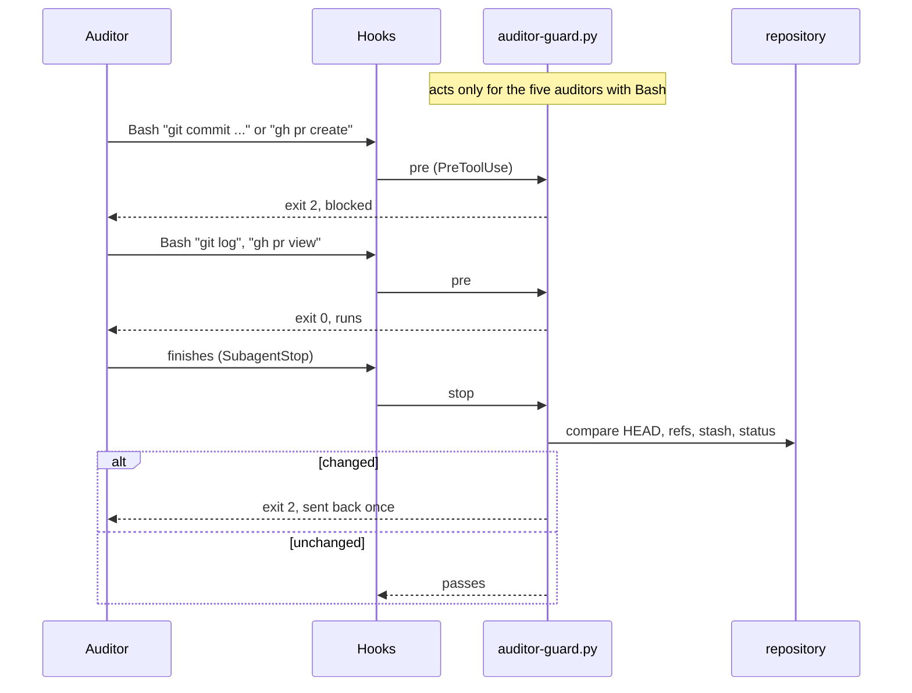

## Phases

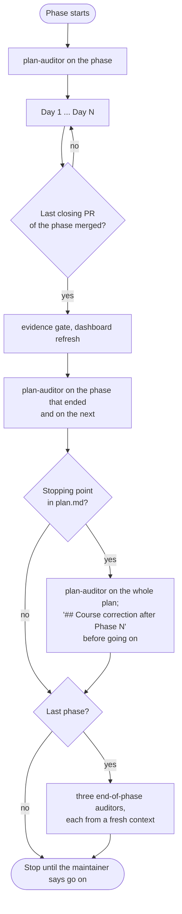

## A day

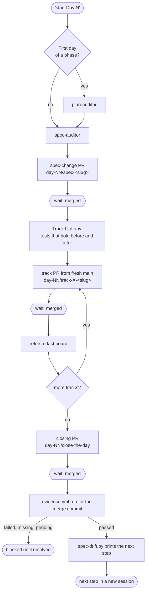

Branches never stack: each starts from `main` after the previous one merged.

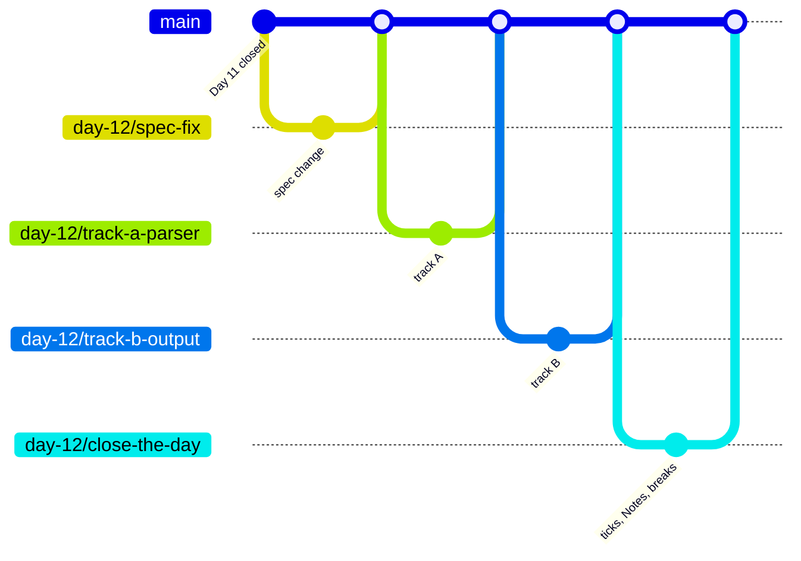

A track, between two "merged":

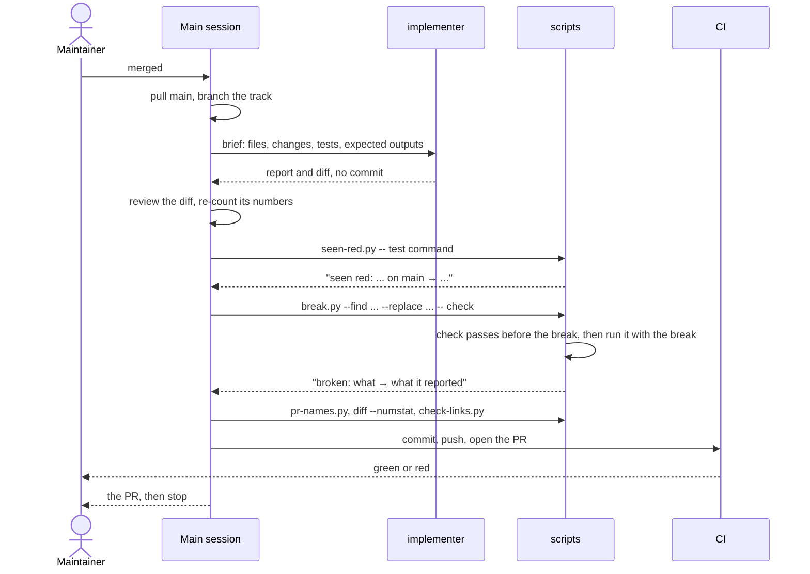

## A criterion

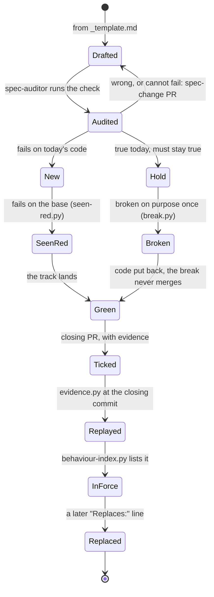

Outside the days, a small behaviour change takes a short spec:

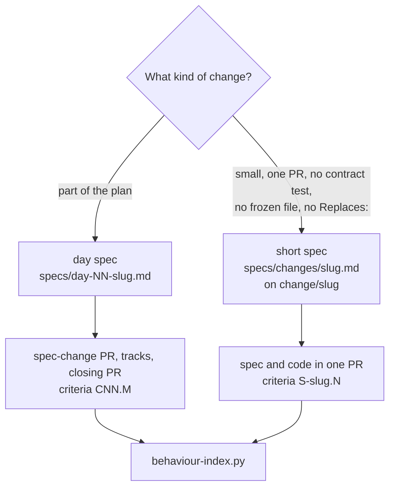

## Before a push

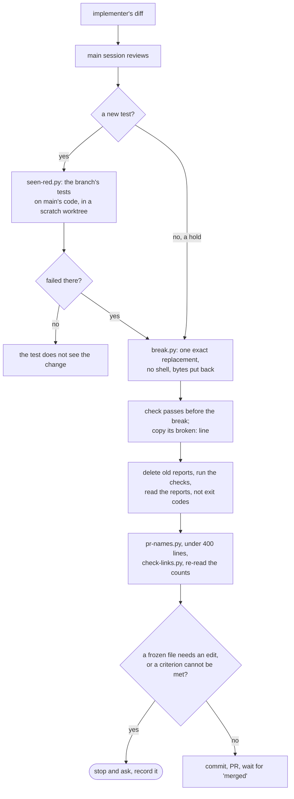

## CI

On every pull request, `pr-checks.yml` runs the scripts; `spec-drift-tests.yml` tests the
dashboard script when it changes.

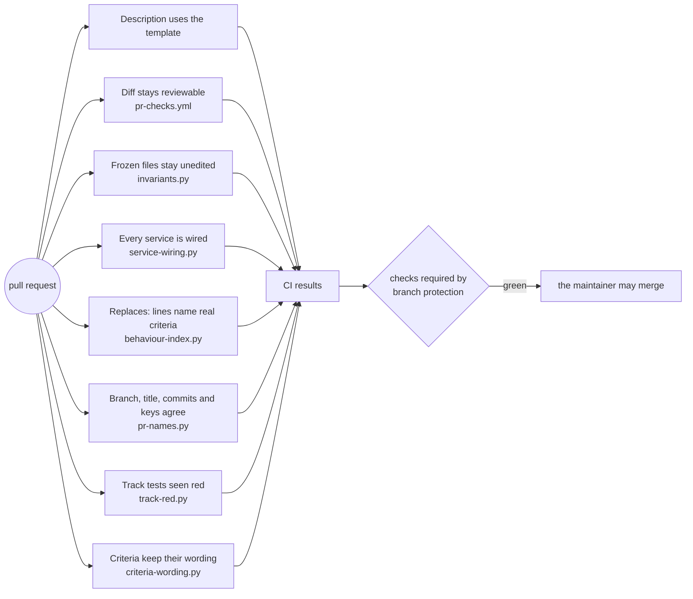

Branch protection must be configured separately; not every CI job shown is required by the
starter configuration. `Track tests seen red` also needs `TRACK_RED_RUNNER=unittest` to run
its checks. The project must add and require its own test workflow; see the
[setup instructions](../README.md#starting-a-project-from-it).

## The close

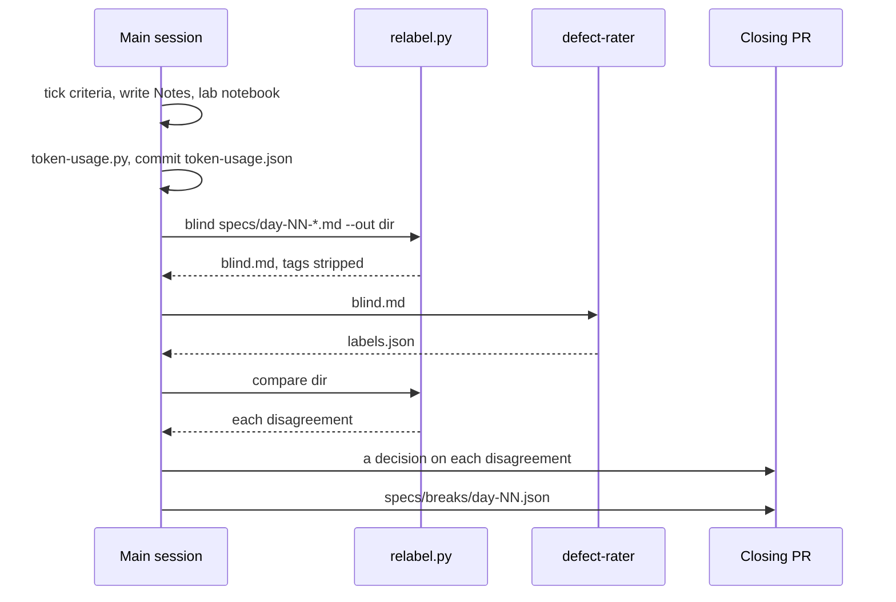

After a closing PR merges, including by squash merge, CI replays its evidence. The next session
checks the run for that closing commit before advancing; this gate is procedural, not an automatic
block on starting work:

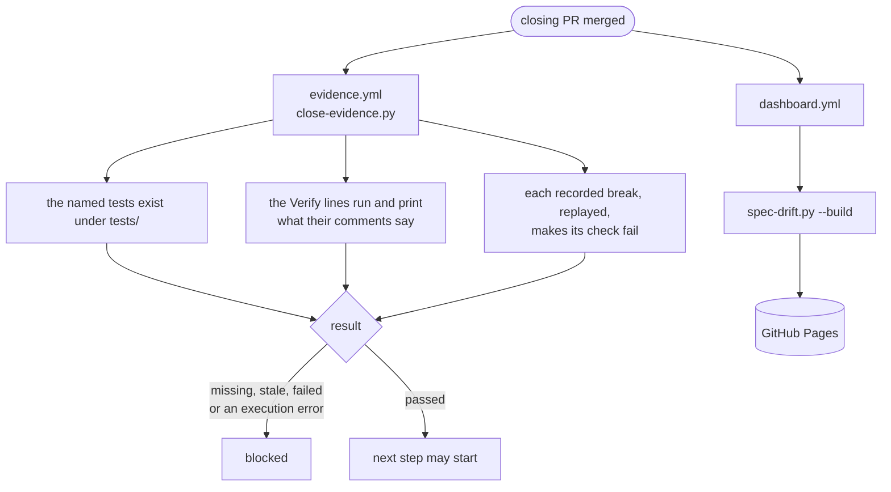

## The dashboard

[`scripts/spec-drift.py`](../scripts/spec-drift.py) reads git, GitHub and the specs, and builds
the page; the page runs nothing.

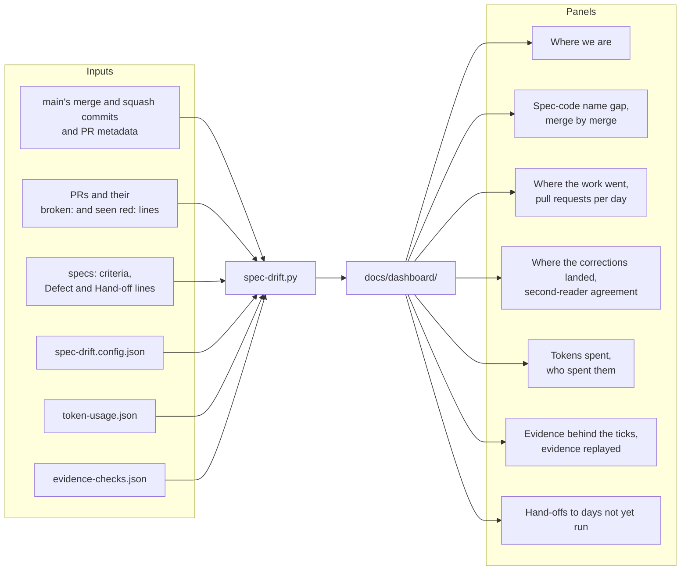

## One session per step

Every reply re-reads the whole conversation, so a step starts in a new session; the files carry
what it needs.

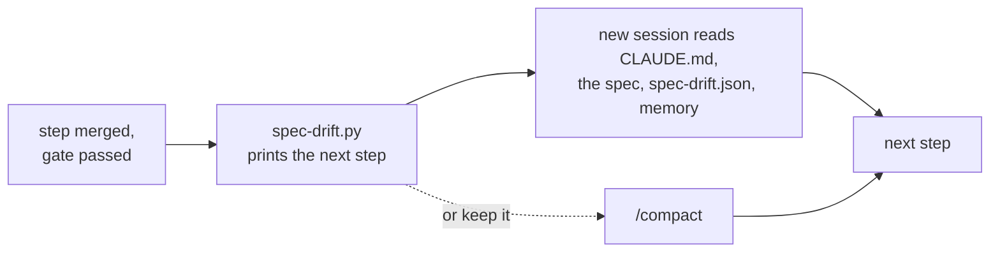
